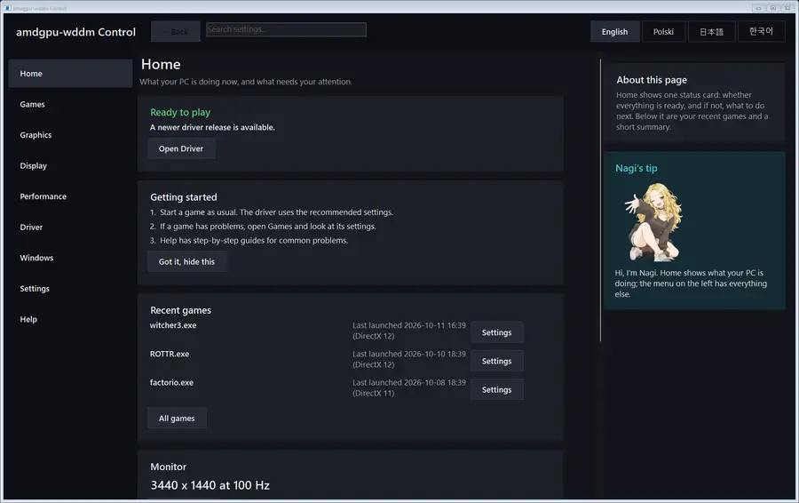

<p align="center"></p>

<h1 align="center">
  <picture>
    <source media="(prefers-color-scheme: dark)" srcset="docs/media/nagi-lockup-dark.svg">
    
  </picture>
</h1>

<p align="center"><b>Nagi's AMD Graphics Infrastructure</b>, the driver project also known as amdgpu-wddm.<br>
<sub>Yes, the N is Nagi again. We borrowed the recursive acronym from GNU and took it to Windows. Linux fans, please send complaints to /dev/null (here it is called NUL).</sub></p>

Nagi is an open Windows driver for AMD GPUs, made first for the ASRock BC-250 (AMD Cyan Skillfish APU, gfx1013). The Windows
desktop, Direct3D 12, Direct3D 11 and Vulkan games run on the GPU of the board. Inside, the kernel driver uses AMD's
own amdgpu code, and Mesa RADV, DXVK and vkd3d-proton work behind the standard Windows runtimes. The driver is
experimental and has a test signature. Not affiliated with or endorsed by AMD, ASRock or Microsoft.



## Install

You need an ASRock BC-250 with Windows 11 x64, version 23H2 or newer, and an internet connection.

1. Download the setup program from the [latest release](https://github.com/D-Ogi/amdgpu-wddm/releases/latest).
2. Run it and click Install. It checks the board, downloads the AMD GPU firmware, turns on the test mode of
   Windows and restarts the computer.
3. After the restart, Nagi Control App shows the driver, the clocks, the temperature and the fan.

The installer stops on a computer that is not a BC-250 and changes nothing there. Secure Boot must be off. The stock
BC-250 BIOS has no Secure Boot, so it is off already. Removal, settings and what to do when something fails:
[installation guide](docs/testing/INSTALL.md). Report a problem in [Issues](https://github.com/D-Ogi/amdgpu-wddm/issues)
and attach the support file that the installer or the control app makes.

## Status

<!-- status-map (generated by tools/docs/status_map.py, do not edit) -->

<a href="docs/status/README.md">


</a>

<!-- /status-map -->

| Area | Works | Not yet |
|---|---|---|
| Desktop | DWM composes on the GPU. Hardware acceleration for supported GDI drawing operations. DisplayPort, and HDMI through a passive adapter | Modes above 300 MHz pixel clock (144 Hz and more at 1440p). Some GPU hangs (paging engine, 3DMark Time Spy) still stop Windows. Resume from hibernation |
| Direct3D 12 | System runtime, feature level 12_1. The Windows 11 23H2 runtime gets shader model 6.6 and DXR 1.1. The Witcher 3 Remaster with ray tracing | Conformance suites |
| Direct3D 12 with Agility SDK 1.619 / 1.721 | Shader model 6.9, shader execution reordering and DXR 1.2 with opacity micromaps. Mesh and amplification shaders, work graphs tier 1.0, enhanced barriers. Partial graphics programs (driver interface 0122) | Full conformance. Work graphs in 32-bit programs, measured |
| Direct3D 11 | System runtime, feature level 12_1. Direct3D 10.0 and 10.1 programs also run on the GPU | - |
| Direct3D 9 | D3D9On12 of Windows on our Direct3D 12 driver, for 64-bit and 32-bit programs | - |
| Vulkan | Mesa RADV with ray tracing. Quake II RTX path-traces | Full conformance (CTS) run |
| OpenGL | OpenGL 4.6 on the GPU for 64-bit programs, through Zink | 32-bit programs (they get the software OpenGL of Windows) |
| Compute | Separate Vulkan and Direct3D 12 compute queues. Vulkan compute (llama.cpp), an early HIP runtime of our own | Full HIP compatibility |
| Video | H.264 encoding through Media Foundation | Recording by a standard Windows application, measured |
| AMD application interfaces | ADL for 64-bit and 32-bit programs that use AMD AGS: adapter, memory, driver and screen information | Other AMD software features |
| Clocks and cooling | Automatic GPU clock up to 2000 MHz, fan control, unlock of all 40 compute units | - |
| Other AMD GPUs | - | The driver starts only on a BC-250 today |

GDI acceleration and the separate compute queue are on by default. You can turn either off in Nagi Control App.
Each change takes effect after a restart. The driver starts with 24 compute units. The control app lets you unlock more.

Each measured result and its evidence: [facts](docs/facts.md). The milestone criteria and their state:
[reconciliation](docs/m15-reconciliation.md). The changes of each release: [release notes](docs/testing/release-notes/).

## For developers

- [Architecture](docs/architecture.md): the design, the driver layers and their measured limits.
- [Facts](docs/facts.md) and [evidence rules](docs/01-evidence-rules.md): every hardware claim has a status and a
  link to raw results.
- Linux (`amdgpu` and RADV) on the same unit is the reference for every Windows measurement.
- Register addresses come from AMD's MIT-licensed code, never from hand calculation
  (`tools/regcalc`, [addressing](docs/02-register-addressing.md)).
- [Contributing](CONTRIBUTING.md) and the [writing standard](docs/style.md).

## Build

[docs/build.md](docs/build.md) builds the kernel-mode driver, LLVM, the Mesa components, DXVK and vkd3d-proton
from pinned sources. Register lookups need only Python:

```
python tools/regcalc/regcalc.py lookup mmGRBM_STATUS mmSPI_PG_ENABLE_STATIC_WGP_MASK
python tools/regcalc/regcalc.py reverse 0x5C3C
python -m unittest discover -s tools/regcalc
```

## In numbers

Lines of our own source on 2026-10-28 (main 1ac39efe and the fork branches of tester.33), counted as cloc and
tokei count them: code lines exclude blank lines and comment lines, and comments have their own column. Imported code
(amdgpu, DML, `third_party/`), generated tables and `evidence/` are not in the count. A fork counts the lines that its
branch adds to the upstream code it is based on.

| Part | Code | Tests | Comments |
|---|---|---|---|
| Driver: kernel mode, user-mode shells, shim, contract | 110,000 | 112,000 | 44,000 |
| Tools: installer, control app, release and quality gates, lab tools | 185,000 | 30,000 | 28,000 |
| Compute (HIP runtime) | 15,000 | 12,000 | 6,000 |
| Experiments and lab procedures | 62,000 | 3,000 | 3,000 |
| Our changes in the forks: vkd3d-proton, Mesa, DXVK, dxil-spirv | 48,000 | 43,000 | 11,000 |
| **Total** | **420,000** | **200,000** | **92,000** |

Blank lines add about 49,000 more, and the documentation about 140,000. <sub>Kropla drąży skałę: dripping water hollows out the stone.</sub>

## Repositories

| Repository | What it holds |
|---|---|
| [D-Ogi/amdgpu-wddm](https://github.com/D-Ogi/amdgpu-wddm) (this one) | Kernel-mode driver, UMD shells, contracts, installer, control app, tools, evidence and facts |
| [D-Ogi/mesa-amdgpu-wddm](https://github.com/D-Ogi/mesa-amdgpu-wddm) | RADV with the WDDM winsys, and the Mesa UMD builds (llvmpipe, Zink) |
| [D-Ogi/dxvk](https://github.com/D-Ogi/dxvk) | DXVK as the Direct3D 11 engine of the driver |
| [D-Ogi/vkd3d-proton](https://github.com/D-Ogi/vkd3d-proton) | vkd3d-proton as the Direct3D 12 engine of the driver |
| [D-Ogi/dxil-spirv](https://github.com/D-Ogi/dxil-spirv), [D-Ogi/dxbc-spirv](https://github.com/D-Ogi/dxbc-spirv) | The shader compilers that the two engines pin |

The branch and the commit of each file of a release are in `tools/release/release-sources.json`.

## Repo map

| Path | Contents |
|---|---|
| `docs/` | Goal and roadmap, evidence rules, ADRs (`adr/`), design notes (`design/`), research notes, [hardware notes](docs/hardware.md) and [what the gfx1013 silicon really does](docs/gfx1013-isa.md) |
| `docs/facts.md`, `docs/facts/` | The only list of established facts, generated from the facts graph in `docs/facts/data/` |
| `experiments/`, `evidence/` | Experiments `Exx` (hypothesis, procedure, expected result, result). Raw results from hardware, immutable once added |
| `regs/` | Generated register tables (never edited by hand) |
| `driver/kmd/`, `driver/contract/` | The WDDM kernel-mode driver `bc250kmd` and the private KMD/UMD contract |
| `driver/shim/`, `driver/amdgpu-import/` | AMD's imported, unmodified amdgpu code and the slice of the Linux API it needs |
| `driver/icd/`, `driver/umd/` | RADV WDDM winsys patches, the Direct3D 10/11 shell over DXVK and the Direct3D 12 shell |
| `tools/release/`, `tools/win/` | Installer and release build. Control app, measurement and lab tools |
| `tools/build/`, `tools/quality/` | Build recipes and build quality gates |
| `third_party/` | Foreign code kept in the repo, with provenance and license |

## License

Copyright (c) 2026 D-Ogi. Source-available under the **PolyForm Noncommercial License 1.0.0** (`LICENSE.md`): free for noncommercial use, modification and sharing, provided the `Required Notice` lines in `NOTICE` stay attached. No commercial use, including bundling with hardware or OS images for sale. Reasons: `docs/adr/0004-polyform-noncommercial.md`.

Third-party code keeps its own license (`THIRD-PARTY.md`). AMD firmware blobs are not part of this repo.

**Beware of fakes.** This project publishes its source and its releases on GitHub only, never Windows images, installers from file hosts or BIOS files. See `SECURITY.md`.

<sub>Thanks to [lonewolf0622](https://github.com/lonewolf0622) for the RDNA 1 mesh shader work in [bc250meshtaskwork](https://github.com/lonewolf0622/bc250meshtaskwork), which Nagi uses.</sub>
