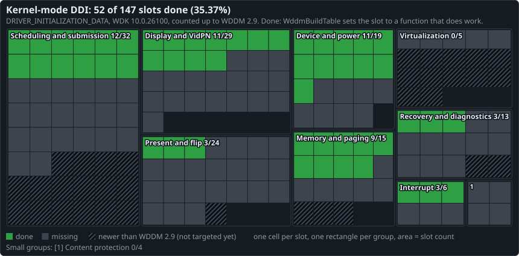
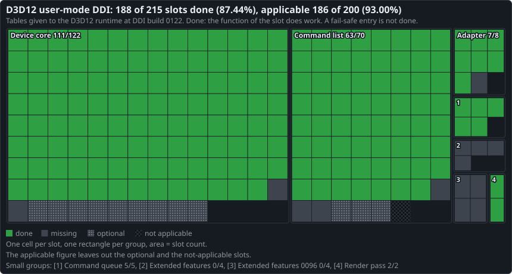

# DDI coverage

Generated by `tools/docs/status_map.py` from the source. Do not edit.

## Kernel-mode DDI: 52 of 147 slots (35.37%)

Slots of `DRIVER_INITIALIZATION_DATA` (`km/dispmprt.h`, WDK 10.0.26100) up to WDDM 2.9, the version that `WddmBuildTable` declares. Hatched cells: the 34 slots of WDDM 3.0 and later, not counted. All versions: 52 of 181 (28.73%).

## D3D12 user-mode DDI: 187 of 215 slots (86.98%)

Tables at DDI build 0120: `D3D12DDI_ADAPTERFUNCS`, `D3D12DDI_DEVICE_FUNCS_CORE_0088`, `D3D12DDI_COMMAND_LIST_FUNCS_3D_0092`, `D3D12DDI_COMMAND_QUEUE_FUNCS_CORE_0001`, `D3D12DDI_RENDER_PASS_FUNCS_0053`, `D3D12DDI_EXTENDED_FEATURES_FUNCS_0021`, `D3D12DDI_EXTENDED_FEATURES_FUNCS_0096` (for command lists, the graphics table). 10 of the missing slots hold a fail-safe entry of engine-ddi.

## Counting rule

A slot is done when its function can return success and does work. Logs, counters, error reports, zero writes and a failure constant on every path are not work. 7 kernel-mode and 8 user-mode done slots refuse some inputs. The script reads the source and does not run the driver: done means that the code exists, not that a test passed. `status.json` gives each slot with its function, source line and reason.
