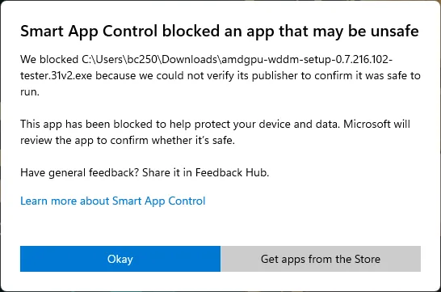
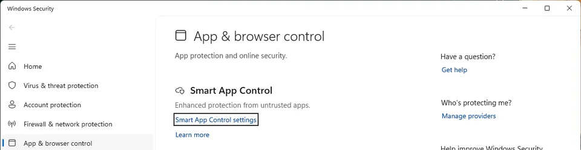
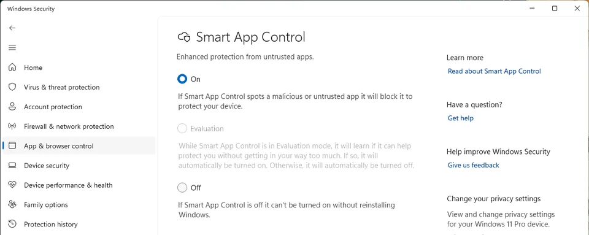
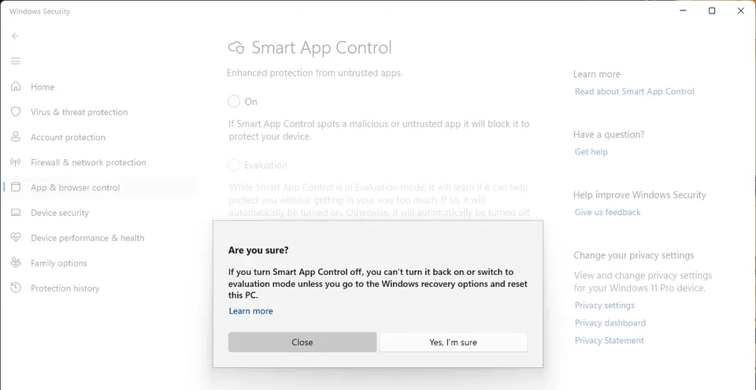
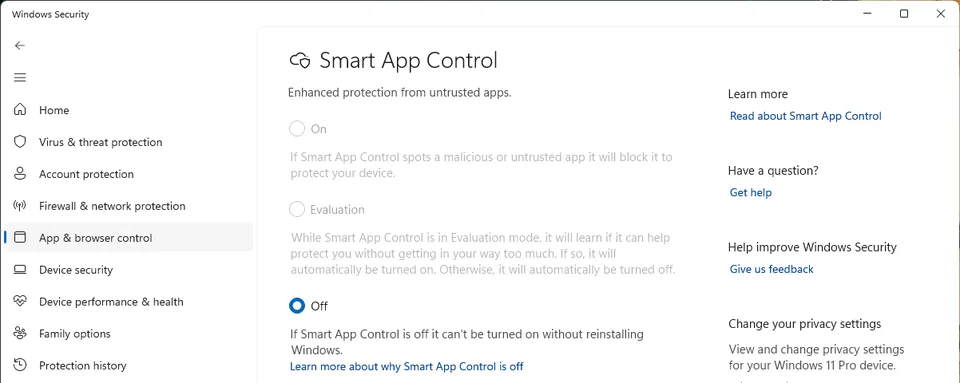
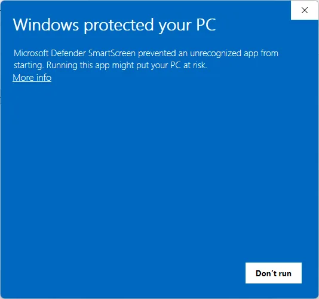
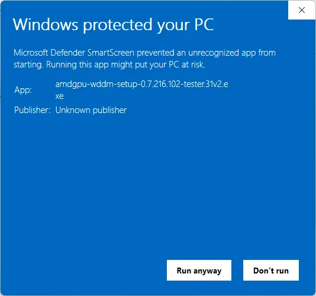

# amdgpu-wddm tester release: installation guide

This package installs the amdgpu-wddm GPU driver on an ASRock BC-250 board (AMD Cyan Skillfish GPU, gfx1013,
PCI device 1002:13FE) with Windows 11 x64. The driver is experimental. It is signed with a test certificate, so
Windows must run in test mode.

Use this package only on a BC-250. The installer stops on every other computer and changes nothing there.

## What you need

- An ASRock BC-250 with Windows 11 x64 installed and working on Microsoft Basic Display Adapter. The driver is
  tested on Windows 11 23H2 (build 22631), 24H2 (build 26100) and 25H2 (build 26200), and on the general builds
  after them. An older Windows 11 (build 22000 to 22630) gets a line that advises an update, and the installation
  continues. An Insider build (Canary, Dev or Beta) and an LTSC edition each get a line of the same kind. A PC in the
  Insider programme that runs one of the three tested builds reads no such line. Windows 10 and older are refused.
- A local account with administrator rights.
- Secure Boot off. The stock BC-250 BIOS has no Secure Boot option, so it is already off (see "Secure Boot" below).
- Smart App Control off. While it is on, Windows blocks the setup program and the driver (see "Smart App Control
  and SmartScreen" below).
- If BitLocker is on: your BitLocker recovery key, in case something goes wrong. The installer pauses BitLocker
  by itself for the restarts it needs and tells you that it did.
- Nothing to install first. The driver's programs need the Microsoft Visual C++ 2015-2022 Redistributable (x64),
  and the package carries Microsoft's own installer for it. The installer runs it when this PC has no
  `vcruntime140.dll`, `vcruntime140_1.dll` or `msvcp140.dll` in `System32`, or when one of them is older than
  14.44. It checks the SHA-256 and the Microsoft signature of that file first, and it needs no internet for this
  step. Nothing happens when the runtime is already there. If Windows answers that the runtime is registered but a
  file of it is missing, the installer repairs it with the same file.
- 2 GB of free space on the system drive.
- A keyboard and a monitor on the BC-250.
- An internet connection during the installation: the installer downloads the AMD GPU firmware (see "GPU firmware"
  below). Without one, download the files on another computer and give the installer the folder.

## Before you start

1. Make a backup of all data on the BC-250 that you want to keep.
2. Write down your BitLocker recovery key if BitLocker is on: open a command prompt as administrator and type
   `manage-bde -protectors -get C:`.
3. Make sure that Smart App Control is off. A new installation of Windows 11 can have it on or in evaluation mode.
   While it is on, Windows blocks the setup program and the driver. See "Smart App Control and SmartScreen" below.
4. Take one of the two downloads of the release:
   - **One file** - `amdgpu-wddm-setup-<version>.exe`. Copy it to a local folder and double-click it. It carries the
     whole package inside itself, unpacks it where only administrators may write, checks every file, and installs
     from there. It removes that folder when the installation is over. Nothing else to do.
   - **The zip file** - unpack it to a local folder, for example `C:\amdgpu-wddm-tester`. Do not run the installer
     from the zip file or from a network drive. Unpack the whole zip: the folder it makes holds `setup.exe` and the
     folder `files`, and `setup.exe` needs `files` next to it. To carry the package to another computer or to a
     memory stick, copy that whole folder, not the folder `files` alone: the package checks `setup.exe` too, and
     `files` on its own reports `missing setup.exe`. The command line below needs this download.
5. Optional: do a dry run first. In the folder `files`, open a command prompt and type `install.cmd -DryRun`.
   The dry run does all checks and shows all changes, but it changes nothing.

## Secure Boot

Windows does not load a test-signed driver while Secure Boot is on.

The stock BC-250 BIOS versions P2.00, P3.00 and P5.00 have no Secure Boot option. Secure Boot is not built into
that firmware, so it is always off and you do nothing here. The preflight shows Secure Boot
`off (not built into the firmware)` and names where it read that answer.

A modified BIOS can have the option. If the preflight shows Secure Boot `on`, turn it off:

1. Restart the BC-250 and push `Del` (or `F2`) to open the BIOS setup.
2. Find the Secure Boot setting. It is usually under Security > Secure Boot. Set it to Disabled. Some modified
   BIOS versions have no switch for it: set OS Type to "Other OS", or delete the Secure Boot keys.
3. Save and exit (usually `F10`).

To read the setting yourself, open PowerShell as administrator and type `Confirm-SecureBootUEFI`:

- `True`: Secure Boot is on.
- `False`: Secure Boot is off.
- The red error "Variable is currently undefined": Secure Boot is off. The firmware does not hold the setting
  at all. The stock BC-250 BIOS gives this error. The installer reads the firmware itself and shows
  `off (not built into the firmware)` for the same board.
- "not supported": Secure Boot is off. The computer started from a legacy BIOS.

`msinfo32` shows the same value as "Secure Boot State".

The installer does not change BIOS or firmware settings.

## Smart App Control and SmartScreen

Two protections of Windows can stop this release: Smart App Control and Microsoft Defender SmartScreen. This
release carries the signature of a test certificate, and Microsoft does not know that certificate. A release with a
signature that Microsoft trusts is the solution. Until that release, do the steps in this section.

### Smart App Control

If you start the setup and Windows shows this message, Smart App Control is on:



The message comes 30 to 60 seconds after you start the setup. It has no button that starts the setup. Select
"Okay", turn Smart App Control off with the steps below, and then start the setup again.

Smart App Control is a part of Windows 11 22H2 and later. It runs only the programs that a publisher signs and
Microsoft trusts. A new installation of Windows 11 can have it on, or in evaluation mode. While it is on, Windows
blocks two parts of this release:

- The setup program. Windows blocks it before its window opens, with the message above.
- The user-mode drivers (`bc250d3d.dll` and `bc250d3d_zink.dll`), in every program and in the desktop compositor
  (DWM). The desktop and games then cannot use the driver.

In evaluation mode, Windows can turn Smart App Control on later by itself. Then Windows blocks the user-mode drivers
in the same way, and the desktop and games lose the driver. Turn Smart App Control off before you install.

The installer reads the state of Smart App Control before it changes anything:

- On: the preflight shows a `fail` line for Smart App Control and stops. The installer changes nothing. The
  console (`install.cmd -Console`) shows the steps in the `fail` line.
- Evaluation: the preflight shows a `warn` line, and the installation continues. The setup window shows the steps
  below and the button "Open Smart App Control settings".
- Off, or no Smart App Control on this Windows: the preflight shows an `ok` line.

To turn Smart App Control off:

1. Open Windows Security. To find it, type `Windows Security` in the Start menu. In the setup window, the button
   "Open Smart App Control settings" opens the page of step 3 directly.
2. Select "App & browser control", and then "Smart App Control settings".

   

3. The page "Smart App Control" shows the state: On, Evaluation or Off. Select "Off".

   

4. Windows asks "Are you sure?" and shows this text: "If you turn Smart App Control off, you can't turn it back
   on or switch to evaluation mode unless you go to the Windows recovery options and reset this PC." Select
   "Yes, I'm sure".

   

5. Accept the administrator prompt. The page then shows Off as the selected option. You cannot select On or
   Evaluation now.

   

6. Start the setup again. If the setup window is open, go back to it and continue. An installation that stopped
   part way continues at the step that failed.

After this change, you cannot turn Smart App Control on again or select evaluation mode until you reset this PC from
the Windows recovery options.

### SmartScreen

When Smart App Control is off and you start the downloaded setup, Microsoft Defender SmartScreen can show the
message "Windows protected your PC". SmartScreen shows it for a program that few people started before, and each
release of this driver is new. At first the message has only the button "Don't run". To start the setup:

1. Select "More info".

   

2. The message now shows "App:" with the name of the program file, and "Publisher: Unknown publisher". Make sure
   that the name is `amdgpu-wddm-setup-<version>.exe` or `setup.exe`.

   

3. Select "Run anyway". The setup starts. "Don't run" closes the message and does not start the setup.

You do not have to turn SmartScreen off.

## Install

The usual way is the setup window:

1. Double-click `amdgpu-wddm-setup-<version>.exe`, or, in the unpacked folder, `setup.exe`. It is the only file
   there. Everything else is in the folder
   `files` beside it. The window asks for administrator rights itself: accept the prompt. (`install.cmd` in the
   folder `files`, started with no switch, opens the same window.) If Windows shows "Windows protected your PC",
   select "More info" and then "Run anyway". If Windows shows "Smart App Control blocked an app that may be
   unsafe", turn Smart App Control off first (see "Smart App Control and SmartScreen").
2. The window checks the computer first. The check changes nothing. Then the window shows the checks that need
   attention, what it will change, the restarts and the release notes.
3. Press "Install". The window asks you for nothing else. It says what it will change - Windows test mode on,
   and BitLocker paused for the restarts if BitLocker is on - because you should know it, not because it needs
   your permission for it: you opened the installer to install the driver, and pressing "Install" is the decision.
4. The window installs the driver and shows each stage. Before each restart of Windows it counts down 15 seconds
   and then restarts by itself. Press "Restart now" to go at once, or "Later" to keep the computer running and
   save your work first. After you log on again, the window starts by itself and continues (accept the
   administrator prompt).
5. At the end the window shows the result. On a problem it offers to try again or to repair, and it can save a
   support file for your report.

The setup window installs the driver only. It does not install llama.cpp, Ollama or a model. For these, install
with `install.cmd` on the command line (see "The extras" below).

On the command line, `install.cmd` with any switch installs the same release in the console window, as before.
`install.cmd -Console` does the same with no other switch, and you can put `-Console` beside the other switches,
for example `install.cmd -Console -DryRun`:

1. In the folder `files` of the unpacked folder, open a command prompt as administrator and type `install.cmd`
   with the switches you want. With no switch `install.cmd` opens the setup window instead, so type
   `install.cmd -Console` when you want the console.
2. Read the preflight table. Every line must show `ok` or `warn`. A `fail` line stops the installer, and the
   installer tells you what to correct. When it stops at preflight, it has changed nothing.
3. Phase 1: the installer makes a System Restore point (if System Protection is on), turns on test signing and,
   if BitLocker is on, pauses BitLocker for the restarts it needs. It asks you nothing: it prints
   what it changes as it changes it. The restart comes after a 15-second countdown. Press Enter to restart at
   once, or any other key to restart later yourself.
4. Let the computer restart. After you log on, the installer starts again by itself (accept the administrator
   prompt). If it does not start, run `install.cmd` again.
5. Phase 2: the installer downloads the GPU firmware and checks it, then installs the certificate, the driver, the
   user-mode drivers and the firmware, and sets the registry values. The screen does not change: the GPU changes to
   the new driver at the next start. Then the computer restarts again.
6. Phase 3: after the second logon, the installer verifies the driver and shows a pass or fail table.

You can run the verification again at any time with `verify.cmd` in `C:\Program Files\amdgpu-wddm`.

To install a newer package, unpack it to a new folder and start its setup window or its `install.cmd`. You do not
have to uninstall first. The installer shows `upgrading <old> -> <new>`, keeps the files that did not change,
replaces the others and restarts the computer. Running `install.cmd` of the version that is already installed and verified does nothing;
use `install.cmd -Repair` to install it again.

An upgrade keeps the settings you changed: the driver settings (for example `DpmMaxMHz` and `CuMode`), `DwmForceCpu`,
the D3D11 allowlist and the application profiles. The installer writes a new default only over a value that the
previous installer wrote and that you did not change. The upgrade output shows each value as `new`, `unchanged`, `KEPT`
(your value) or `->` (new default). A value given on the command line (`-DpmMaxMHz`) is always written. The
installer always writes its own values: the file paths, the graphics registration and the start counter
`UnconfirmedStarts`. The Control application can set the defaults again.

"Test Mode" is shown in the lower-right corner of the desktop while test signing is on. This is normal.

## The extras: llama.cpp, Ollama and the models

Before phase 1 the installer asks whether it shall also install the two programs that run language models on the
board: our build of llama.cpp and our build of Ollama. The answer `yes` is the default, so Enter is enough. After
the two questions it shows a short list of models with their size and their licence. The answer for the models is
none.

Both programs go into `C:\Program Files\amdgpu-wddm\tools`. The model files go into
`C:\Users\Public\Documents\amdgpu-wddm\models`. Every download is checked against the SHA-256 in this package. A
download that does not match is refused, and the driver installation goes on without it.

Ollama keeps models in its own format, in `%LOCALAPPDATA%\bc250-ollama\models`, so a model chosen while both
programs are installed is downloaded twice and kept twice. The question gives both numbers and the sum. Use
`bc250-ollama.cmd` in the Ollama folder to talk to our Ollama server. A bare `ollama.exe` uses the Ollama
defaults.

An installation without a window uses `-Components llama,ollama` or `-NoComponents`, and `-Models gemma12b` or
`-NoModels`. `uninstall.cmd` removes the programs and keeps the models. `uninstall.cmd -RemoveModels` removes the
models as well. The page `docs/testing/llm-components.md` of the project has the whole list of switches.

## GPU firmware

The driver loads eight AMD firmware files from its signed Driver Store package. The ZIP does not contain them. The
installer downloads them, and the AMD licence text `LICENSE.amdgpu`, from the linux-firmware project at commit
`2b8daaf611fbade74f26a5b58ec1defe6a02f5e0`, at every installation and upgrade. It checks the SHA256 of each file
before it stages the driver. It also checks the size and membership of each binary
in the signed catalog. A missing or changed file stops installation before staging.

The installer tries the first address of each file, then the second (3 tries each):

- `https://git.kernel.org/pub/scm/linux/kernel/git/firmware/linux-firmware.git/plain/<path>?id=2b8daaf611fbade74f26a5b58ec1defe6a02f5e0`
- `https://gitlab.com/kernel-firmware/linux-firmware/-/raw/2b8daaf611fbade74f26a5b58ec1defe6a02f5e0/<path>`

| File | `<path>` | SHA256 |
|---|---|---|
| `cyan_skillfish2_ce.bin` | `amdgpu/cyan_skillfish2_ce.bin` | `5946efbf7e46ccfe7e9f965da56c35b1187469d1c1a49c8a9eff433eb3ab4723` |
| `cyan_skillfish2_me.bin` | `amdgpu/cyan_skillfish2_me.bin` | `d4ed4d968de0d7720f7c8215d42fdae727bf99cdf43cee6f8f864dc2584b17e2` |
| `cyan_skillfish2_mec.bin` | `amdgpu/cyan_skillfish2_mec.bin` | `b1c1f843a8faaa2de537d6ba05052a3776b5a1b73f8a3c3f5ed9d568489776a4` |
| `cyan_skillfish2_mec2.bin` | `amdgpu/cyan_skillfish2_mec2.bin` | `b1c1f843a8faaa2de537d6ba05052a3776b5a1b73f8a3c3f5ed9d568489776a4` |
| `cyan_skillfish2_pfp.bin` | `amdgpu/cyan_skillfish2_pfp.bin` | `50e56dc1913571ff589425d2b059bddfc5e8a2b4bc22d3eb78cac75d1e0479a1` |
| `cyan_skillfish2_rlc.bin` | `amdgpu/cyan_skillfish2_rlc.bin` | `20acefdb6128a36275f4382425a109a7c9927f6053eab685bb51164ff1d18cfb` |
| `cyan_skillfish2_sdma.bin` | `amdgpu/cyan_skillfish2_sdma.bin` | `15d0d3626da7f2513f03b13bb7e02eeeeccab276276ae27d0b6067b5f25e9e95` |
| `cyan_skillfish2_sdma1.bin` | `amdgpu/cyan_skillfish2_sdma1.bin` | `bd1c0b0f6a6a4f17ede034f2c844b6553fc444e08915c7bb500c09fde59d6255` |
| `LICENSE.amdgpu` | `LICENSES/LICENSE.amdgpu` | `572872598565dc3513470de971a32bf9db301f47afeef3636345eadae33b2eee` |

The same list is in `manifest.json` (section "firmware"). A dry run (`install.cmd -DryRun`) shows the addresses
and the SHA256 values and downloads nothing.

Without internet on the BC-250:

1. On a computer with internet, download the nine files from the addresses above (replace `<path>`). Keep the file
   names of the first column.
2. Copy them to one folder on the BC-250, for example `C:\amdgpu-wddm-firmware`.
3. Run `install.cmd -FirmwareDir C:\amdgpu-wddm-firmware`. The installer checks the SHA256 of each file the same
   way and uses the folder also after the restarts during the installation. The same goes for `-DpmMaxMHz`,
   `-CuMode`, `-NoControlApp`, `-NoStartMenuShortcut`, `-NoDesktopShortcut`, `-NoWallpaper`, `-NoBootLogo` and
   `-NoReboot`.

## The small blue window after logon

After each logon, a small blue window is shown in the top-left corner for two minutes. It says "Nagi start
check: confirming that the GPU driver started correctly" and counts down to the moment it closes by itself. The driver
counts each start that is not confirmed. After two unconfirmed starts, Windows uses Microsoft Basic Display Adapter
again, to prevent a start loop. The window keeps the desktop drawing for at least one minute, and the confirmation
then confirms the start. The same confirmation keeps the automatic clock control (DPM) on: if a start is not
confirmed, the next start runs at the fixed 1000 MHz clock, and DPM stays off until you set it again in the control
application. Do not close the window.

Two scheduled tasks do this work, and both run at the logon of any user, so an account without administrator rights
confirms a start as well:

- "amdgpu-wddm start confirm" runs as the Local System account (`S-1-5-18`), with the highest run level and no
  window of its own. It reads the driver's start health and confirms the start. The driver accepts a confirmation
  only from an administrator, which is why this task does not run as the user who logs on.
- "amdgpu-wddm start window" runs as the user who logs on, with that user's own rights (the Users group,
  `S-1-5-32-545`, limited run level). It shows the small blue window and nothing else: it never opens the driver and
  changes no setting. The task starts Nagi Control App with `--start-window`, and the control application starts the
  window script without a console window. An install without the control application (`-NoControlApp`) starts the
  script with `powershell.exe`, and then a console window can show at sign-in. The window stays for the full two
  minutes, because this task does not read the confirmation's progress. Earlier releases closed it as soon as the
  start was confirmed, usually after about one minute. If it does not run, the confirmation still keeps the computer
  off Microsoft Basic Display, and the next start runs at the fixed clock.

The confirmation writes its results to `C:\ProgramData\amdgpu-wddm\start-confirm.log`. Its last line of each logon
also reports the state, the last run time and the last result of the window task, so a window that did not run or
could not open is visible there (`last result 0` the window was shown and closed, `2` it could not be shown,
`3` the person turned the clock window off).

You can turn the clock window off: open Nagi Control App, go to Settings and clear "Show the start check window
after sign-in". The setting belongs to the account that sets it, needs no administrator rights, and the window task
then ends at once and reports `3`. Read what it costs before you clear it: without the window the desktop may stop
drawing before the driver has confirmed the start, so the next start can run at the fixed clock instead of the
automatic one, and if the confirmation keeps staying unfinished the driver's own guard switches the driver off
after two such starts, which puts Windows on Microsoft Basic Display Adapter until you turn the driver back on.

## If the graphics driver did not start, you see it at the sign-in

The same window task also starts the control application's own notice (`amdgpu_wddm_control.exe --start-notice`),
which looks for the driver for up to half a minute and stays silent when the driver answers. A driver that was
switched off for safety is already recorded as such, so that notice appears at once. The other case waits out the
half minute, because a driver still inside its own start looks the same from outside. It is a separate window from
the blue clock, and the setting above never switches it off.

- The driver was switched off for safety (two starts did not finish their check, so Windows now uses its basic
  display driver: no games, low performance). The notice says that in plain words and offers three buttons:
  "Turn the graphics driver back on...", "Open Nagi Control App" and "Close".
- The driver did not start for another reason. The notice says so and offers "Open Nagi Control App" and
  "Close".

"Turn the graphics driver back on..." sets the count of unconfirmed starts back to 0 and restarts the graphics
device in place, without a restart of Windows. The notice counts the seconds while it works: it can take up to
four minutes, and the screen can go dark for a moment. The notice then waits for the driver and confirms this
start itself, so the next start of Windows does not count it against you. If the device does not come back, the
notice says that Windows has to be restarted and offers a button for it. "Close" stays usable the whole time, and
the repair finishes whether the notice is open or not.

The home page of Nagi Control App carries the same button while the driver stays switched off, for a person who
closed the notice, and the Recovery page (Help, with "Show support options" on) explains the state in "Support:
driver states" and offers the same repair as "Turn the graphics driver back on" in "Support: actions". You no
longer have to run the release installer again for this.

## What the installer changes

| Item | Location |
|---|---|
| Test signing | `bcdedit /set '{current}' testsigning on` |
| Test certificate | LocalMachine Root and TrustedPublisher stores |
| Microsoft Visual C++ 2015-2022 Redistributable (x64) | installed by Microsoft's own installer from `payload\redist\vc_redist.x64.exe`, only when `System32` has no `vcruntime140.dll`, `vcruntime140_1.dll` or `msvcp140.dll`, or one of them is older than 14.44. Microsoft's files go where Microsoft puts them. `uninstall.cmd` leaves this runtime in place, because other programs use it |
| Kernel-mode driver | driver package `bc250kmd.inf` (driver store, service `bc250kmd`) |
| Driver settings | The shared service state returned by Windows. Nagi Control App and `bc250kmd_cli state` use the same reader. Installation defaults remain separate from user choices and driver records. See `docs/design/driver-state.md` |
| User-mode drivers | `C:\Program Files\amdgpu-wddm\` (`d3d12`, `desktop`, `d3d11`, `vulkan`, `opengl`, `wow64`, `tools`, `control`, `mft`). Nothing goes into `C:\Windows\System32` or `C:\Windows\SysWOW64`. An install over an earlier release removes the `bc250umd.dll` that it put there |
| H.264 encoder (Media Foundation) | `HKLM\SOFTWARE\Classes\CLSID\{A32438F0-0D79-4CA9-A5BF-9F3C80837253}` with its `InprocServer32`, `HKLM\SOFTWARE\Classes\MediaFoundation\Transforms` (the encoder's own key and its membership in the video encoder category). These keys are for the whole computer. `uninstall.cmd` removes them, and so does a later release that does not install the encoder |
| Licence texts | `C:\Program Files\amdgpu-wddm\licenses` (the package's `licenses\` and `THIRD-PARTY.md`) |
| Graphics registration | the GPU's software key: `UserModeDriverName`, `VulkanDriverName`, `OpenGLDriverName`, `OpenGLVersion`, `OpenGLFlags`. For 32-bit applications: `UserModeDriverNameWow` and `VulkanDriverNameWow`. This release writes no `OpenGLDriverNameWow`, `OpenGLVersionWow` or `OpenGLFlagsWow`: it has no 32-bit OpenGL driver (see "What this release does" below). The first entry of each `UserModeDriverName` value, the Direct3D 9 entry, holds `<>`. Also `HKLM\SOFTWARE\Khronos\Vulkan\Drivers` and `HKLM\SOFTWARE\WOW6432Node\Khronos\Vulkan\Drivers`. `uninstall.cmd` puts back an `OpenGL` value from before the install, with the registry type it had. It removes the ones it added, even when the installer state file is gone. An `OpenGL` value that belongs to another driver stays. It does all that whether or not Windows still shows the GPU, because the files the values name go with the install |
| Router policy and profiles | `HKLM\SOFTWARE\amdgpu-wddm` |
| GPU firmware | Eight binaries beside the KMD image in Driver Store. `LICENSE.amdgpu` is in the installed `licenses` folder. The installer downloads or retrieves pinned copies before staging. The repair set retains them for offline repair. |
| Shortcuts of Nagi Control App | Start menu and desktop, for all users: "Nagi Control App", "Nagi Control App (recovery)" in the Start menu and "Nagi Control App" on the desktop. Both places are written by default. The setup window has a box for each place. On the command line `-NoStartMenuShortcut` and `-NoDesktopShortcut` leave one out. `-StartMenuShortcut` and `-DesktopShortcut` ask for a place an earlier run left out. The box you clear holds over the restarts of the installation. `uninstall.cmd` removes all three |
| Start confirmation | two scheduled tasks, both at the logon of any user. "amdgpu-wddm start confirm" runs as the Local System account. "amdgpu-wddm start window" runs as the user who logs on, shows the clock window and starts the control application's sign-in notice |
| Settings of the person who signs in | `HKCU\Software\amdgpu-wddm\Control` of that account (language, the switches of the control application, "Show the start check window after sign-in"). The application itself writes this key when you change a setting. The installer does not. No administrator rights, nothing for other accounts. `uninstall.cmd` removes the key of the account that runs it, and leaves the keys of other accounts |
| Shortcuts of an earlier release | earlier releases named the shortcuts "amdgpu-wddm Control". An install over such a release and `uninstall.cmd` remove those old shortcuts when they point at the control application. A file of that name that points elsewhere stays |
| Nagi wallpaper | for each person who signs in after the installation is checked, Nagi Control App sets the Nagi wallpaper once (position Fill). It saves the previous background of that person first. The setup window has a box for it, on by default. `install.cmd -NoWallpaper` leaves it out. In Nagi Control App, Settings, "Nagi wallpaper" sets it again or restores the previous background. A slideshow or Windows Spotlight comes back as its last picture only. `uninstall.cmd` changes nobody's background and keeps the picture in `%LOCALAPPDATA%\amdgpu-wddm\wallpaper` |
| Nagi on the start screen | while Windows starts, the driver draws Nagi above the ring of dots. She is there for about half a second, between the ring of dots and the black screen that follows it, so you may miss her if you look away (`docs/design/boot-logo.md`). The setup window has a box for it, on by default, and `install.cmd -NoBootLogo` leaves her out. The answer is `Parameters\BootLogo` of the driver (absent is on, 0 is off), so an installation over an earlier one keeps the answer you gave it. In Nagi Control App the same switch is on the Display page. `uninstall.cmd` removes the value |
| Installer state and logs | `C:\ProgramData\amdgpu-wddm` (the Control application keeps its setting backups and action log in its `control` folder) |

If you type the `bcdedit` command yourself, keep the quotation marks around `'{current}'` in PowerShell.
PowerShell reads `{current}` without them as a command of its own. In a command prompt (`cmd`) the quotation
marks are not necessary.

Default driver settings: automatic clock control (DPM) on, maximum 2000 MHz. The thermal limits of the driver do not
change. The driver writes no debug log files. To change the maximum clock at install time, use
`install.cmd -DpmMaxMHz <1000-2000>`. An upgrade keeps a maximum clock that you set (see "Install").

Graphics cores: the driver uses 24 of the 40 compute units of the GPU after a normal install. This is the number the
firmware of the board switches on. To install with all of them, use `install.cmd -CuMode 40`. After the install, the
Graphics page of Nagi Control App holds the choice: a number of cores from "Standard (24)" to "All (40)" in steps of
two, because the hardware switches the cores on in pairs. Under "Choose the pairs of cores yourself" the same page
shows a map of the pairs, where you select each pair that the driver may use. A new number applies at the next
restart of Windows. The first start with more than 24 cores needs the confirmation of the small blue window after
logon. Without that confirmation the next start goes back to 24 and records the reason. The number that you select is
kept by every later install: the Graphics page and the switch both record it as your choice. If one pair of cores
makes this PC stop or restart, select that pair off on the map and leave the other pairs on. The change writes
registry values and no firmware. More cores give more performance in many games, and also more power and more heat.
The game results that we publish are measured with all 40 cores. The page `docs/design/cu-mode.md` of the project has
the whole description.

## What works and what does not

- Desktop composition (DWM) runs on the GPU (`DwmForceCpu` 0 in `HKLM\SOFTWARE\amdgpu-wddm\DesktopRouter`). When the
  driver has closed the GPU desktop path (for example after a start that ended in a crash or a power loss), DWM uses
  the CPU route by itself. The home page of Nagi Control App then opens with a notice that says so in plain words,
  and its one button, "Turn it all back on", opens everything the driver closed that way: the GPU desktop path and
  the automatic clock together. "Reopen the GPU desktop path" on the Recovery page opens the path alone.
  `DwmForceCpu` 1 keeps the
  desktop on the CPU route. An upgrade keeps the value you set.
- Direct3D 12 applications run on the GPU through the Windows Direct3D 12 runtime, at feature level 12_1.
- Vulkan applications run on the GPU through the Vulkan ICD.
- 64-bit OpenGL applications run on the GPU through the OpenGL driver (ICD) of this release. Windows loads it
  for every 64-bit OpenGL program of the computer, with no file beside the program. `verify.cmd` shows the
  line `OpenGL ICD` with the registration and the driver file. Without this driver Windows gives an OpenGL
  program its own software renderer, which is OpenGL 1.1.
- 32-bit OpenGL applications keep that software renderer of Windows, which is OpenGL 1.1. This release has no
  32-bit OpenGL driver: that driver draws through Vulkan, and a 32-bit program reaches Vulkan through the
  32-bit Vulkan loader of the computer, `C:\Windows\SysWOW64\vulkan-1.dll`. No release of ours installs that
  loader, and the test computer has none, so the 32-bit OpenGL driver would load and then give the program no
  OpenGL at all. `verify.cmd` says so in one line. 32-bit Direct3D programs are not affected and run on the
  GPU: the 32-bit Direct3D 10, 11 and 12 drivers of this release use our Vulkan driver directly, without that
  loader. A 32-bit Vulkan application does need it. This release registers its 32-bit Vulkan driver for a
  computer that has one.
- Direct3D 11 applications and games run on the GPU, and so do the components of Windows and the packaged
  Microsoft applications. The value `Mode` in `HKLM\SOFTWARE\amdgpu-wddm\AppRouter` holds `gpu-default`, and the
  `Allow` and `Deny` lists beside it are empty in a new install. These programs stay on the CPU route (software
  rendering): the processes of the logon and lock screens, a program whose image the router cannot resolve, a
  program you put in the `Deny` list, a program you set to processor rendering in Nagi Control App, and
  `PickerHost.exe` and `SecHealthUI.exe`, which the driver keeps there by itself. `PickerHost.exe` is the program
  behind the Windows firewall notification window ("Windows Security") and behind the file open and save windows.
  That firewall window stayed white and empty on the GPU route. `SecHealthUI.exe` is the Windows Security app. On
  the GPU route, the desktop compositor (DWM) stopped and started again about every 7 seconds while its window was
  open. So the driver sends these two programs to the processor. An entry in the `Allow` list puts a program back
  on the GPU, `PickerHost.exe` and `SecHealthUI.exe` included. `Mode` `allowlist` gives the
  behaviour of the earlier releases: the CPU route for every program, and the GPU only for the programs in
  `Allow`. Use the Direct3D 12 mode of a game if it has one.
- Direct3D 9 applications run on the GPU through D3D9On12, the Direct3D 9 layer of Windows on top of our Direct3D 12
  driver. The installer writes `<>` in the Direct3D 9 entry of `UserModeDriverName`, and Windows then loads
  `d3d9on12.dll` by itself. Windows 11 24H2 and 25H2 do not start a GPU whose Direct3D 9 entry is empty.
- 32-bit Direct3D 10/11/12 and Vulkan applications use 32-bit builds of the same drivers (folder `wow64`), with the
  same routing rules as 64-bit applications. A 32-bit Vulkan application also needs the 32-bit Vulkan loader of the
  computer, which no release of ours installs (see the two OpenGL entries above). 32-bit Direct3D 9 applications use
  D3D9On12 on the 32-bit Direct3D 12 driver, as 64-bit ones do.
- The Witcher 3 (Direct3D 12 version) has an application profile.
- A program that records video can use the H.264 encoder of the GPU through Media Foundation. The encoder works only
  while Windows runs the BC-250 on this driver: if the driver did not start, the encoder refuses, and the program
  uses an encoder of Windows. `verify.cmd` shows the line `H.264 encoder` with the file that the registration names.

## If something fails

- Preflight `fail`: correct the item that the table names, then run `install.cmd` again.
- Windows shows "Smart App Control blocked an app that may be unsafe" after you start the setup, or the installer
  stops with "An Application Control policy has blocked this file": Smart App Control is on. Turn it off (see
  "Smart App Control and SmartScreen"), then start the setup again. The installer continues at the step that failed.
- Preflight `fail` on `GPU firmware`, or the installer stops at the firmware step: the computer cannot reach the
  download addresses, or a file has a different SHA256. Connect the computer to the internet, or use
  `-FirmwareDir` (see "GPU firmware").
- The installer stops with `stopped at step: ...`: the message names the step and the cause. Correct the cause if
  you can, then run `install.cmd` again from the same `files` folder of the package. The installer skips the steps that are
  complete and continues at the step that failed.
- The installer stops at the step that adds the release test certificate, with `Windows refused to add the
  certificate to LocalMachine\Root` (or `TrustedPublisher`): setup runs as administrator, so Windows itself refused
  the change. Usually an antivirus program protects the certificate store, or a policy locks the store. Allow the
  change in the antivirus program, or run the `certutil -addstore` commands that the message shows in an
  administrator command prompt. Then run setup again.
- A file that Windows uses (for example a user-mode driver that the desktop has loaded) cannot be overwritten. The
  installer renames it to `<name>.old-<time>`, copies the new file and deletes the old copy at the next restart.
- The screen stays black after a restart: wait two minutes. If it stays black, restart the computer with the power
  button. After two failed starts, Windows uses Microsoft Basic Display Adapter again.
- Windows uses Microsoft Basic Display Adapter again (no games, low performance, the picture is slow): at the next
  sign-in a notice says so and offers "Turn the graphics driver back on..." (see "If the graphics driver did not start,
  you see it at the sign-in"). The same button is on the home page of Nagi Control App and in "Support: actions"
  on its Recovery page.
  It needs no restart of Windows and no second run of the installer. Make a bug report first if the developers
  should see why the driver was switched off: the repair clears the count the driver kept. If the notice ends by
  asking for a restart of Windows, use the button it offers. If the driver is switched off again after that
  restart, make a bug report instead of repairing a second time.
- The desktop is black after an update, but programs still start: open Nagi Control App (`Win`, then type its
  name) and select "Desktop on the CPU route" on its Recovery page. Otherwise use Safe Mode and `uninstall.cmd`
  (next item).
- To start Windows without the driver: hold `Shift` and select Restart, then Troubleshoot > Advanced options >
  Startup Settings > Restart > `3` (Enable low-resolution video), or `4` (Safe Mode). Then run `uninstall.cmd`.
- Verification fails: run `verify.cmd`, then make a diagnostics bundle (see "How to report a bug").
- Verification says that the driver did not start: the installer collects the readings itself. It writes one
  file, `diagnostics-<time>.txt`, next to its log in `C:\ProgramData\amdgpu-wddm\installer`, and the setup
  window puts the same file into the support file it saves. The console route prints the path of both files in
  its last lines. Send them with the report: they hold the problem code of the device, the driver's own record
  of the start and of the stop, the event-log entries of that start, and the setup log sections of the
  graphics device. Nothing is sent by itself.
- After an installation, `verify.cmd` fails `GPU desktop path` with `closed by the driver` or `last boot died in a
  session`, and the desktop runs on the CPU route: run `install.cmd -Repair`. It sets the switches of the release back
  and restarts Windows. You can also open Nagi Control App: its home page shows the notice about this state, and
  "Turn it all back on" there opens the same things as the repair: the GPU desktop path and the automatic clock.
  The driver removes its own record of the clock at the next start. "Reopen the GPU desktop path" in "Support: actions" on the Recovery page opens
  the path alone, and "Reopen what the driver closed" there is the same action as the button on the home page.
  Restart Windows afterwards. A normal installation, an upgrade and a plain re-run of `install.cmd` keep the closed path
  and name it in the report, because the driver closed it for a reason. If the driver closes the path again, make a
  bug report instead of repairing a second time.
- The Graphics page shows 24 graphics cores and you selected more: the driver went back to 24 after a start with the
  larger number that nobody confirmed. Select your number again on the Graphics page and restart Windows. 24 is the
  number of a normal install, so a repair does not change it. If the driver goes back a second time, select a smaller
  number, or turn one pair of cores off on the map, and make a bug report.
- Windows 11 apps (the command bar of File Explorer, Task Manager) ignore mouse clicks, often after the screen went
  black for a moment, or `verify.cmd` shows `[warn] DWM restarted in this session`: WinUI pointer-input loss after the
  desktop compositor (DWM) is terminated and restarted reproduces on this Windows build also with Microsoft Basic
  Display; restart Windows to recover. If the compositor crashed, make a bug report: a crash can still be a driver
  defect. `verify.cmd` reports only a replacement it saw: the start-confirm task records the compositor at each
  logon, and without that record the line says `unknown history`.

## Uninstall

1. Run `uninstall.cmd` as administrator (in the package's `files` folder or in `C:\Program Files\amdgpu-wddm`).
2. The uninstaller asks nothing: starting it is the answer. It removes the driver, the files, the registry values,
   the tasks and the certificate. The GPU goes back to Microsoft Basic Display Adapter. The uninstaller keeps
   `C:\ProgramData\amdgpu-wddm\control` (the Control application's setting backups and action log). Delete it
   yourself if you do not need it.
3. Test signing goes off again where the installer turned it on. `uninstall.cmd -KeepTestSigning` leaves it on, for
   a tester who installs another build of ours next.
4. The restart that finishes the removal starts by itself after a 15-second countdown: Enter restarts at once, any
   other key leaves the restart to you, and `uninstall.cmd -NoReboot` skips it. If BitLocker is on, have the
   recovery key ready: changing the boot options again can cause a recovery key prompt.

You can also use the System Restore point "amdgpu-wddm before install" if the installer made one.

## How to report a bug

1. Open "Nagi Control App" from the Start menu and select the bug report function.
2. The application shows the list of files and the text of each file before it writes anything. Read them.
3. The application writes one zip file to your desktop: `amdgpu-wddm-report-YYYYMMDD-HHMMSS.zip`. It sends
   nothing.
4. Open a bug report on GitHub: https://github.com/D-Ogi/amdgpu-wddm/issues/new/choose, then "Bug report". Fill in
   the package version, the game or application and its API, the settings, what you did, what you expected, what
   happened, and the time of the problem.
5. Attach the zip file to the issue.

The zip file contains these files:

| File | Contents |
|---|---|
| `driver-state.txt` | driver version; clock control (mode, maximum, clocks, voltage, temperature, load, throttle reason); start health; desktop composition (CPU or GPU); video memory statistics |
| `driver-log.txt` | the driver's internal log ring |
| `installed-files.txt` | release version and folder; Device Manager status and problem code; the GPU's driver key (INF version and date, driver name values); driver, Vulkan manifest and library files with file version and SHA-256 |
| `settings.txt` | the shared driver settings, their read status, and the Direct3D 12 application profiles |
| `system.txt` | Windows build, test signing state, application version, UTC time |
| `events.txt` | System log entries of the last 24 hours from the display driver, DirectX kernel, DWM, crash reporting, power and Plug and Play, and application errors that name the driver, DWM, Direct3D or Vulkan |
| `dxdiag.txt` | `dxdiag /t` output (only if you select it; it takes about one minute) |
| `d3d12-caps.json`, `vulkan-summary.txt` | Direct3D 12 and Vulkan capabilities (only if you select them) |

Before the preview, the application removes from every file: your user name, your profile path (shown as
`%USERPROFILE%`), the computer name, MAC addresses, e-mail addresses, and every value on a line that names a serial
number, machine ID, product ID or UUID. It also removes the account name of every other `C:\Users\<name>` path,
the security identifiers, and the computer name of an event entry. Versions, hashes and hardware IDs stay, because
we need them.
If you find personal data in the preview, do not send the file, and tell us in the bug report so that we can
correct the application.

## Optional Windows tuning

The setup window offers Windows tuning. This option starts unchecked.
Select it to apply the control application's recommended background settings through its shared backend.
The package manifest and command-line plan list the choices from that application's catalog.
Use the control application's Windows settings page for individual changes and recovery.

For a command-line installation, add `-ApplySystemTuning` to `install.cmd`.
The choice survives an installation restart or a failed attempt.
Use `-SkipSystemTuning` to cancel a saved choice when retrying.
The setup executable accepts `--apply-system-tuning`.
Plan and dry-run modes show the choice without running the tuning backend.

The uninstaller offers to restore machine-wide settings before removal.
Use `uninstall.cmd -RestoreSystemTuning` to select this action or `-KeepSystemTuning` to keep the settings.
A failed restoration stops removal.
The uninstaller preserves machine and user recovery records, including those belonging to other accounts.
It also keeps verified recovery scripts under `%ProgramData%\amdgpu-wddm\system-tuning-recovery`.

After removal, restore each account's settings from that account:

```powershell
powershell -NoProfile -File "$env:ProgramData\amdgpu-wddm\system-tuning-recovery\system-tuning.ps1" -Action RestoreAll -Scope User
```

Elevation with another account does not restore the original account's settings.
Machine-wide recovery uses the same command with `-Scope Machine` from an administrator terminal.
