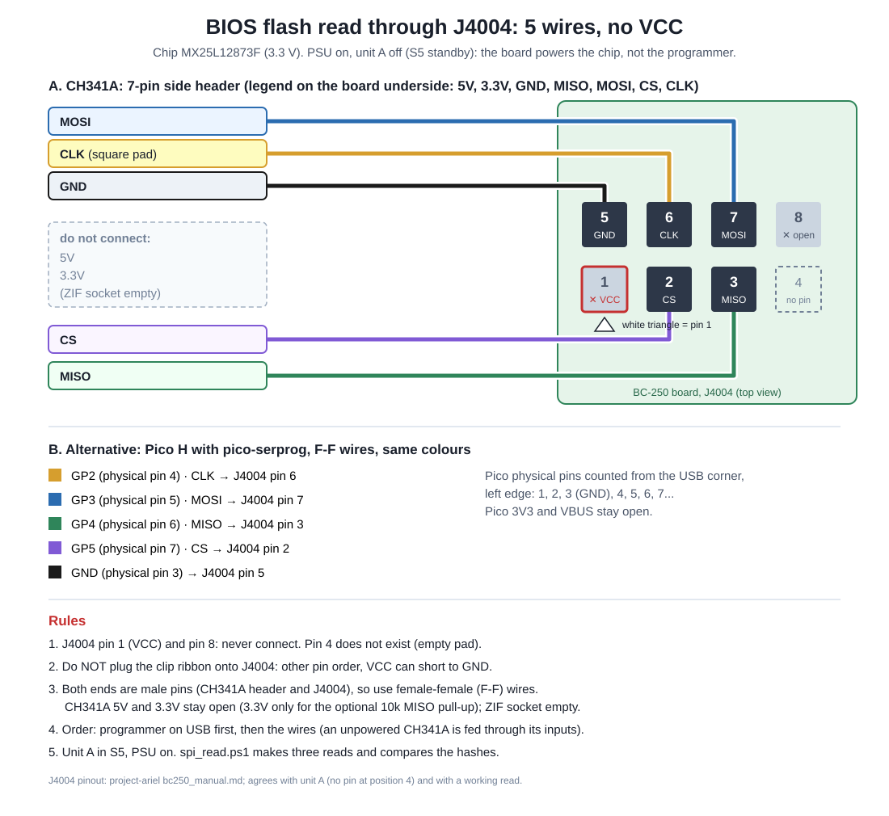

# tools/spiflash

Reads the BIOS SPI flash of the BC-250 through the J4004 header with a CH341A programmer: a full image with
flashrom, and the chip registers, SFDP, protection bits and secured OTP with an own raw-SPI transport. No
raw-SPI transport can write the flash. A separate guarded wrapper can write through flashrom.
Measured state of unit A:
[M965](../../docs/facts/hardware.md#m965), [M966](../../docs/facts/hardware.md#m966).

| File | Use |
|------|-----|
| `spi_read.ps1` | Image backup: probe with `-V` (records the status register), then 3 flashrom reads, equal hashes, optional NAS copy |
| `spi_write.ps1` | Planned write or explicit restore with pinned inputs and complete readbacks |
| `ch341a.py` | CH341A raw-SPI transport (libusb through ctypes, no pip package), read-class opcodes only |
| `spi_regs.py` | Registers, SFDP, lock, fast boot, password, SPB/DPB, secured OTP. RDID and a READ against the backup gate it |
| `miso_float_check.py` | Negative control: the MISO level while the chip does not drive SO |
| `test_spiflash.py` | Host tests against a simulated programmer: `python -m unittest discover -s tools/spiflash` |
| `test_spi_write.py` | Writer tests with synthetic images and a fake flashrom process |
| `check_spi_write_mutations.py` | Checks that removing a write guard makes its test fail |
| `winusb/` | WinUSB binding for the CH341A (inbox driver, own INF, local self-signed catalog) |
| `j4004-wiring.svg` | Wiring diagram |
| `j4004-pico-h-wiring.svg` | Wiring diagram for the Pico H with the libreboot serprog firmware |

## The flash and J4004 on unit A

- Chip `BIOS_A1`: Macronix MX25L12873F, 3 V, 16 MiB, JEDEC ID `C2 20 18`. flashrom 1.2 has no entry for it.
  Use `-c "MX25L12835F/MX25L12845E/MX25L12865E"` (same ID, same read commands).
- J4004, top view, the white triangle marks pin 1:

  ```
  top:     5 GND    6 CLK    7 MOSI   8 (strap, leave open)
  bottom:  1 VCC    2 CS#    3 MISO   4 (no pin)
  ```

  The layout is from project-ariel `bc250_manual.md`. It agrees with unit A (no pin at position 4) and gave
  a correct read. A table that puts SCLK on pin 4 is wrong for this board.
- WP# and HOLD# are tied high on the board. Pin 1 (VCC) stays open: the board powers the flash from the
  standby rail.



## Procedure

1. Install the WinUSB binding once (elevated): `pwsh -File tools/spiflash/winusb/install_winusb.ps1 -WorkDir <dir outside the repo>`.
2. CH341A jumper on pins 1-2 (SPI mode, USB ID `1a86:5512`). On pins 2-3 the device is a UART (`1a86:5523`) and
   flashrom reports "Couldn't open device 1a86:5512".
3. The CH341A must give 3.3 V signals. The common black board gives 5 V on its data lines until it is modified
   (pin 28 lifted and connected to the 3.3 V regulator output).
4. Shut down unit A cleanly and leave the PSU on (S5, about 14 W at the wall). The flash is then powered and the
   chipset SPI controller is idle.
5. Connect the programmer to USB first, then the 5 wires (CS, MISO, GND, CLK, MOSI to J4004 pins 2, 3, 5, 6, 7).
   An unpowered CH341A gets power through its inputs from the board.
6. Backup: `pwsh -File tools/spiflash/spi_read.ps1 -OutRoot <firmware dir> -NasRoot <NAS dir>`.
7. Registers: `python -I tools/spiflash/spi_regs.py <read1.bin> <new dir>`.
8. Disconnect the wires, then do an AC cycle and a boot test.

## Write and restore

Use PowerShell 7. Set `BC250_ROOT` to the private workspace.
Keep images, backups and output directories under that workspace, outside every repository.
Do not use reparse paths for these files or directories.

Keep one operator in control of the programmer.
The writer mutex excludes another writer using this wrapper.
It does not exclude raw-SPI tools, the backup wrapper or another program.
Stop those tools before this procedure.

1. Complete the candidate's offline gates and record the recovery procedure.
2. Review the write, erase and unlock compatibility of the chip definition.
   Matching read commands or a JEDEC ID alone does not establish write compatibility.
3. Put the board in S5 and connect J4004 as specified above.
4. Take consistent fresh backups and preserve an independent copy.
   A boot can change the variable store after an earlier backup.
5. Build the candidate from that fresh base and the exact approved edits.
   Preserve all bytes outside those edits.
6. Prepare a JSON plan with the fields below and compute its SHA-256.
7. Run the writer with the plan and image hashes.
8. Inspect `result.json`, the readback hash and the status-register records.
9. Disconnect the programmer wires before the planned boot test.

The plan has these fields:

| Field | Required value |
|---|---|
| `schema`, `unit`, `purpose` | `1`, `A`, and `vcn-load`, `vcn-repair` or `p6-l1` (exact lower case) |
| `mode` | `write` or `restore` |
| `chip`, `chip_size` | Exact flashrom chip definition and `16777216` bytes |
| `image_sha256` | Full candidate hash |
| `base_sha256` | Full fresh backup hash for write mode |
| `backup` | Object with `path` and `sha256` of the recovery image |
| `edits` | Write-mode array of objects with integer `offset` and equal-length hexadecimal `before` and `after` |
| `flashrom_sha256`, `flashrom_version` | Executable hash and `flashrom v1.2` |
| `flashrom_dependencies` | Array of objects with `path` and `sha256` for the shipped DLLs |
| `write_compatibility` | Object with `path` and `sha256` of the reviewed chip-write contract |
| `programmer` | Optional. Absent: the CH341A (`ch341a_spi`). Present: the object below, for the Pico with the serprog firmware |

The `programmer` object has these fields, and each must have exactly this value or form:
`kind` = `serprog`, `port` = `COM<n>`, `baud` = `115200`, `spispeed` = `2M`, `name` = `pico-serprog`, and
`transport_review` = an object with `path` and `sha256` of the reviewed transport contract (serprog and the
firmware). The writer makes the flashrom programmer string from these fields. A command-line parameter cannot
change the programmer.

For a serprog programmer the writer first runs the Windows `mode` command for that port with `dtr=on rts=on`
and stops when the answer does not show DTR on. flashrom 1.2 on Windows does not assert DTR. Measured on
unit A: with DTR off a probe passes and an array read fails, and with DTR on full reads are equal.
Each probe must report the chip on the planned programmer, and for serprog also the firmware name.
`-ModeExe` names another program for the port setup. It is for the host tests.
`result.json` records the programmer (`programmer`) and the port setup (`port_setup`).

Pin `libusb-1.0.dll`, `libftdi1.dll` and `libwinpthread-1.dll` beside this flashrom build.
These are its non-system PE imports, including transitive imports.
Windows components and libusb's conditional system backend loaders are outside that file pin set.
The compatibility review must cover the selected USB backend and programming setup.
The wrapper checks the review's identity. It cannot judge its technical contents.

```powershell
$env:BC250_ROOT = '<private-workspace>'
pwsh -NoProfile -File tools/spiflash/spi_write.ps1 `
  -Image <candidate.bin> -ImageSha256 <candidate-sha256> `
  -BaseSha256 <fresh-backup-sha256> -PlanFile <write-plan.json> -PlanSha256 <plan-sha256> `
  -OutRoot <private-output-directory> -Flashrom <reviewed-flashrom.exe> -MaxSectors 1
```

The writer checks inputs before it calls flashrom.
It reconstructs the candidate from the backup and the approved edits.
It programs a private snapshot with a held handle that prevents replacement or writes.
Two fresh pre-reads must agree and match the planned base.
Every native exit code is checked.
PASS requires flashrom's verification, one complete matching readback and a saved result.
`-SecondReadback` adds a second complete readback for diagnosis. It costs about three minutes.
`result.json` records the number of readbacks that completed (`readbacks`).
A write error stays FAIL even when the readback matches.

`MaxSectors` counts differing 4 KiB regions, not physical erase operations.
Flashrom selects erase blocks. The count does not bound its physical erase extent or fallback strategy.
This flashrom version can retry with larger blocks, up to a whole-chip erase.
Flashrom's read operation can also change status-register protection bits.
The wrapper records the status before each read and after the operation.
It permits BP/SRWD protection bits to be cleared by the reviewed unlock hook.
Other status bits must match the reviewed `0x40` state. The final status must be `0x40`.
Check CR and SCUR separately during preflight. The status value alone does not establish the complete protection state.
The result distinguishes an array-write invocation from possible status-register changes.

On a failed write, keep S5 and assess recovery from the recorded state.
Do not boot or retry automatically.
Prepare a separate `restore` plan whose image hash equals the identified backup hash.
Use the pinned backup snapshot from the failed run, or its verified independent copy.
Restore mode bypasses the old-base and edit-count limits.
It retains input pins, two consistent pre-reads, native exit checks and full verification.

```powershell
pwsh -NoProfile -File tools/spiflash/spi_write.ps1 `
  -Restore -Image <verified-backup.bin> -ImageSha256 <backup-sha256> `
  -PlanFile <restore-plan.json> -PlanSha256 <restore-plan-sha256> `
  -OutRoot <private-output-directory> -Flashrom <reviewed-flashrom.exe>
```

## Host checks without hardware

Set `BC250_TEST_TMP` to an existing private workspace directory outside repositories.
The tests use synthetic 16 MiB images and an explicit fake process.
They never select the real flashrom executable or open USB.
Run CPU jobs through the workspace host slot when that rule applies.

```powershell
$env:BC250_TEST_TMP = '<private-test-directory>'
python -m unittest discover -s tools/spiflash -v
python tools/spiflash/check_spi_write_mutations.py
```

The mutation check first runs each selected control test.
It then disables one production guard in a private script copy.
The same test must fail when the fake write incorrectly reaches PASS.
The check never edits the production script.

## Traps

- **flashrom `-r` is not read-only.** flashrom 1.2 `prepare_flash_access()` calls the chip unlock hook before a
  read. For this chip definition the hook sends WREN+WRSR when a block-protect bit is set. `spi_read.ps1`
  records the status register with a probe-only `-V` run first.
- **Undriven MISO.** Without a pull-up, the CH341A read `00` on unit A while the chip did not drive SO. With
  10 kOhm from the CH341A 3.3V pin to MISO it read `FF`. A reply equal to the idle level is "no answer", not a
  register value. `miso_float_check.py` shows the idle level, and `spi_regs.py` runs without and with the
  pull-up classify each reply.
- **The CH341A stalls with queued packets.** It stops taking OUT data when about 4 SPI packets of reply wait
  unread (bulk OUT timeout). `ch341a.py` sends one packet per transfer and reads the reply before the next.
- **Fast boot register.** RDFBR (`16h`) does not answer on unit A, although datasheet rev 1.2 does not gate it.
  The die reports SFDP 1.6, newer than rev 1.2 describes, so its command set can differ.
- **The image is not for a repository.** It holds the UEFI variable store and AMD and AMI firmware. It stays in
  the workspace `firmware\` directory and on the NAS. The facts carry only hashes, versions and register values.

PROVENANCE: CH341A vendor protocol constants as used by flashrom 1.2 `ch341a_spi.c` (GPL-2.0-or-later),
reference only, no code copied. MX25L12873F datasheet rev 1.2 (Macronix) for the opcodes.
